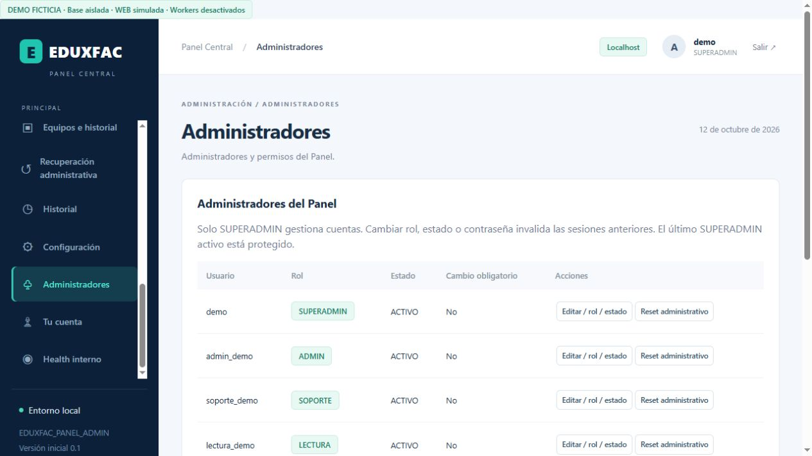

# Resultado final FASE 8 — PANEL EDUXFAC
Fecha: 12 de octubre de 2026. Estado: preparación local validada; producción no desplegada.

## 1. Archivos modificados PANEL
Todos bajo D:\EDUXFAC\PANEL EDUXFAC\01_TRABAJO_ACTUAL\PANEL_EDUXFAC_ACTUAL. Respaldo previo verificado de los12 archivos en D:\EDUXFAC\PANEL EDUXFAC\03_RESPALDOS\FASE8_PRE_POSTGRES_20261012_1008. Lista exacta:
- server/app.mjs
- server/admin-read-service.mjs
- public/app.js
- public/index.html
- public/style.css
- public/admin-dashboard.js
- .env.example
- package.json
- demo/INICIAR_DEMO.mjs
- docs/CHECKLIST_ADOPCION_PRODUCCION.md
- docs/PLAN_ROLLBACK.md
- server/integration-queue.mjs

## 2. Archivos nuevos PANEL
34 archivos principales de implementación/documentación:
- server/db.mjs
- server/postgres-worker.mjs
- server/postgres-dialect.mjs
- server/postgres-migrations.mjs
- server/admin-auth.mjs
- server/panel-runtime.mjs
- server/sqlite-postgres-migrator.mjs
- server/panel-backup-restore.mjs
- server/adoption-dry-run.mjs
- server/phase8-tools.mjs
- public/admin-users.js
- tests/roles-security.test.mjs
- tests/postgres-panel-native.test.mjs
- tests/phase8-operations.test.mjs
- tests/helpers/native-panel-fixture.mjs
- tests/helpers/sqlite-panel-snapshot.mjs
- package-lock.json
- database/postgres-migrations/001_base.sql
- database/postgres-migrations/002_licencias.sql
- database/postgres-migrations/003_onboarding.sql
- database/postgres-migrations/004_estados.sql
- database/postgres-migrations/005_planes.sql
- database/postgres-migrations/006_suscripciones.sql
- database/postgres-migrations/007_operacion.sql
- database/postgres-migrations/008_roles_security.sql
- database/security-migrations/001_roles.sql
- docs/FASE8_POSTGRES_PRODUCCION.md
- docs/MIGRACION_SQLITE_POSTGRES.md
- docs/ROLES_PERMISOS_PANEL.md
- docs/BACKUP_RESTORE_PANEL.md
- docs/ADOPCION_EMPRESAS_EXISTENTES.md
- docs/DEPLOY_ADMIN_EDUXFAC.md
- docs/CHECKLIST_SEGURIDAD_PRODUCCION.md
- docs/PRUEBA_CARGA_PANEL.md

Además: este informe, captura FASE8_ADMINISTRADORES.jpg, siete reportes JSON de evidencia/preservación/ejecución, logs de pruebas, node_modules de pg y laboratorios ficticios con snapshots/clusters/dumps sin ZIP. La DEMO conserva su propia base y logs ficticios. No son datos de producción.

## 3. Cambios WEB
Ningún cambio de código, configuración real, esquema fuente ni datos reales. Se reutilizaron módulos oficiales y fixture nativa de D: para pilotos/pruebas. Solo artefactos de test bajo tests/.native-fase4 y tests/FASE8_REGRESION_WEB.log.

## 4. Esquema PostgreSQL
Base PANEL separada de WEB, esquema panel,40 tablas y ocho migraciones ordenadas001_base→008_roles_security, ledger SHA256 e identidad de IDs/FKs preservada. No escritura dual. Se mantienen fechas/JSON/UUID como TEXT por compatibilidad; PG ledger timestamptz. Runtime sin superusuario/BYPASS/CREATE. App sin DELETE de negocio ni UPDATE/DELETE de historiales; backup solo lectura incluso en secuencias. DELETE app solo para sesiones e intentos. Ver MIGRACION_SQLITE_POSTGRES.md.

## 5. Migrador
server/sqlite-postgres-migrator.mjs + server/phase8-tools.mjs. Copia marcada readonly en tests/.fase8, DB panel_f8_*; transacción única, constraints/triggers controlados, rollback, secuencias, conteos y hashes lógicos. Rechaza SQLite real y herramientas rechazan target real/remoto. Las herramientas no están habilitadas para producción.

## 6. Equivalencia
34 tablas,47 filas de origen ficticio: conteos y SHA256 lógicos iguales en todas; FKs nativas verificadas. IDs, relaciones, fechas, estados e historial conservados. La SQLite original no se abrió como DB de pruebas. Evidencia FASE8_EQUIVALENCIA.json.

## 7–8. Roles y permisos
SUPERADMIN: todo. ADMIN: negocio WEB/clientes/integración/historial; sin usuarios/ajustes ni mutaciones escritorio. SOPORTE: consulta/incidencias/revisión de recuperación; sin precios/planes/pagos. LECTURA: consulta. Backend relee rol/version y deniega acciones no autorizadas; no confía permisos del navegador. Gestión de cuentas protegida, último SUPERADMIN no se degrada/desactiva accidentalmente. Ver ROLES_PERMISOS_PANEL.md para matriz y permisos exactos.

## 9. Sesiones
Token hash + usuario/version, TTL máximo8h, logout/expiración/revocación por rol/reset/desactivación. Scrypt/salt, contraseña temporal exige cambio, sin hashes/contraseñas en respuestas/listados. Origin exacto + JSON, HttpOnly/SameSite=Strict/Secure producción. Login con límites por usuario/peer y peer/socket. Auditoría inmutable integrada al historial. Proxy debe añadir rate limit por cliente antes de VPS.

## 10–11. Backup / restore
Formato custom sin compresión, .dump, fecha/manifiesto/SHA256 y pg_restore --list. Retención configurable solo DRY RUN, sin tareas automáticas ni borrado de dumps. Restauración transaccional aislada tras detener APIs/pools, alteración ficticia recuperada; login, licencias/equipos, historial, pagos y cola verificados. Corrupción rechazada antes del restore. Restauración en clon adicional aprobada. Ver FASE8_BACKUP_RESTORE.json y BACKUP_RESTORE_PANEL.md.

## 12. Carga
2.000 clientes,2.000 empresas,2.000 suscripciones,10.000 pagos,50.000 eventos history,5.012 comandos. Mediciones actuales:
| Operación | p50 ms | p95 ms |
|---|---:|---:|
| dashboard | 443.01 | 510.84 |
| clientes_busqueda | 6.91 | 7.55 |
| empresas_filtro | 30.36 | 31.01 |
| pagos_pagina | 28.75 | 29.05 |
| historial_50000 | 63.79 | 75.79 |
| 10_lecturas_HTTP_concurrentes | 72.70 | — |
| conciliacion_piloto_B | 27.86 | 38.94 |
| worker_cola_5000 | 17.20 | 21.02 |

Valores locales, cinco muestras de lectura/3 de worker; p95 no equivale a SLO productivo. Cola mayormente APLICADA: no se afirma throughput de5.000 comandos pendientes. Las10 lecturas HTTP concurrentes corresponden a clientes paginados. Ver PRUEBA_CARGA_PANEL.md y FASE8_CARGA.json.

## 13. Concurrencia
Pago/renovación con mismo UUID conserva un efecto. Solicitudes simultáneas de plan/límites, estados, conciliación y último SUPERADMIN conservan invariantes. Dos conexiones PG no poseen el mismo lease de integración. Advisory lock de escritores mantiene semántica de transacción histórica. Pruebas/errores quedan aislados.

## 14. Recuperación administrativa
Consulta paginada por cliente/licencia/equipo, motivo y revisión por rol, decisión única y auditoría. Estado aprobado requiere reinstalación por el flujo existente. No se emiten claves, no se reactiva equipo, no se recupera contraseña ni se salta vinculación. Parte final criptográfica queda protegida/bloqueada desde esta nueva vista.

## 15. Piloto A
BASICO ficticio: alta, activación, login, pago manual, renovación idempotente, suspensión con revocación, renovación sin levantar suspensión, reactivación y nuevo login, vencimiento efectivo sin depender del worker. Aislamiento frente B aprobado.

## 16. Piloto B
EMPRESA ficticia: alta/activación, usuarios y sucursales, límites/condiciones simultáneas, conciliación sin sobrescribir conflictos ambiguos, recursos A/B separados. Rol WEB sin superusuario/BYPASS; rol PANEL no puede conectar DB WEB y viceversa. Ver FASE8_PILOTO.json.

## 17. Adopción
adoptionDryRun no abre DB ni contacta VPS. Propone plan/subscripción/fechas pendientes, bloquea inventario inválido/duplicados y no recrea suscripciones. aplicado=false. CLI básica usa inventario JSON ficticio; fechas autorizadas son opciones del módulo. Ver ADOPCION_EMPRESAS_EXISTENTES.md y FASE8_ADOPCION_DRY_RUN.json.

## 18. Rollback
Fallo inducido a mitad de DDL y de import revierte sin datos parciales; post-migración se detienen APIs, se restaura y se recupera operación/cola. Fallo API/worker conserva intentos/UUID/error recuperable y lease; la batería F6 preservada cubre respuesta perdida/replay. Código previo F7 con SHA del respaldo volvió a arrancar sobre copia SQLite ficticia y recuperó login/dashboard. No se restauró código o DB real. Ver PLAN_ROLLBACK.md.

## 19. Health
API interna autenticada APP/DB/WEB snapshot/workers/cola, OK/DEGRADADO/ERROR, sin URLs ni secretos. Snapshot WEB obsoleto (>5min) es DEGRADADO. No implica conectividad actual ni monitor de proceso externo. DEMO muestra SQLite ficticia y workers desactivados; health puede degradarse por error ficticio/edad del snapshot.

## 20–22. Pruebas finales
| Grupo | Aprobadas | Fallidas |
|---|---:|---:|
| WEB anteriores |254|0|
| PANEL anteriores |147|0|
| F8 roles/seguridad |45|0|
| F8 PostgreSQL nativo/pilotos/carga/restore |63|0|
| F8 herramientas/paginación/rollback F7 |15|0|
| Total |524|0|

401 anteriores conservadas +123 nuevas. Pruebas y esquema/migraciones anteriores PANEL:16 hashes coinciden. Respaldo previo:12 hashes coinciden. Originales preservados:10 hashes/tamaños/fechas coinciden, incluidos SQLite/clave. Sintaxis de22 archivos validada. Logs: tests/FASE8_RESULTADO_PANEL_FINAL.log (270/0), WEB/tests/FASE8_REGRESION_WEB.log (254/0). La comprobación posterior no encontró postmaster.pid de fixtures activos.

## 23. Riesgos pendientes
Fachada síncrona bloquea event loop y serializa escritores; capacidad aceptada debe definirse. Fechas/JSON TEXT y collation C requieren ensayo Linux. RLS real WEB no se aplicó: solo política ilustrativa sobre tabla ficticia y A/B SQL/HTTP; revisión completa por tabla/ruta pendiente. Dependencias no tienen auditoría remota CVE en esta fase offline. Credenciales/TLS/HTTPS/backup externo/RPO-RTO/proxy reales siguen pendientes. Herramientas de migración/backup limitadas a laboratorio D: deben revisarse antes de habilitar una operación real.

## 24. Qué falta antes de conectar VPS
Revisar checklist con responsable; aceptar/refactorizar capacidad, revisar dependencia pg/lock y compatibilidad Linux/PG. Validar en staging TLS PG/HTTPS, firewall, cuentas SO/DB mínimas, roles/privilegios y RLS WEB/contexto transaccional. Preparar secretos/cuentas reales offline con custodia/cifrado, sin DEMO. Aprobar inventario DRY RUN/fechas/contratos y migrador productivo controlado; corte consistente y sesiones revocadas. Probar backup externo cifrado, restore/rollback de código+config+DB y RPO/RTO. Solo después autorización nueva de conexión/deploy y workers progresivos. Guía: DEPLOY_ADMIN_EDUXFAC.md y CHECKLIST_SEGURIDAD_PRODUCCION.md.

## 25. Estado estimado
PANEL pasa a una preparación local con PostgreSQL/roles/operación comprobados. **No se certifica listo para producción ni se asigna porcentaje ficticio.** FASE8 local finalizada con gates previos al VPS documentados.

## Confirmaciones y DEMO
Sin fuentes históricas C:, sin VPS/deploy/producción, sin cambios PROPIO/TECNICO, sin secretos reales generados ni migraciones reales. C: solo herramientas/caché del sistema y adjunto del usuario; código oficial y pruebas nuevas en D:. PostgreSQL instalado no se modificó. Sin ZIP. No se habilitaron workers reales. No se abrió puerto público ni se cambió firewall.

DEMO: http://127.0.0.1:4310/#admin-users, demo / DemoEDUXFAC2026!; datos/cuentas/SQLite ficticios, WEB simulada, salida de red deshabilitada. Servidor permanece activo en loopback. Otras cuentas en ROLES_PERMISOS_PANEL.md. Detener desde PANEL D: con powershell -NoProfile -ExecutionPolicy Bypass -File "D:\EDUXFAC\PANEL EDUXFAC\01_TRABAJO_ACTUAL\PANEL_EDUXFAC_ACTUAL\demo\DETENER_DEMO.ps1".

